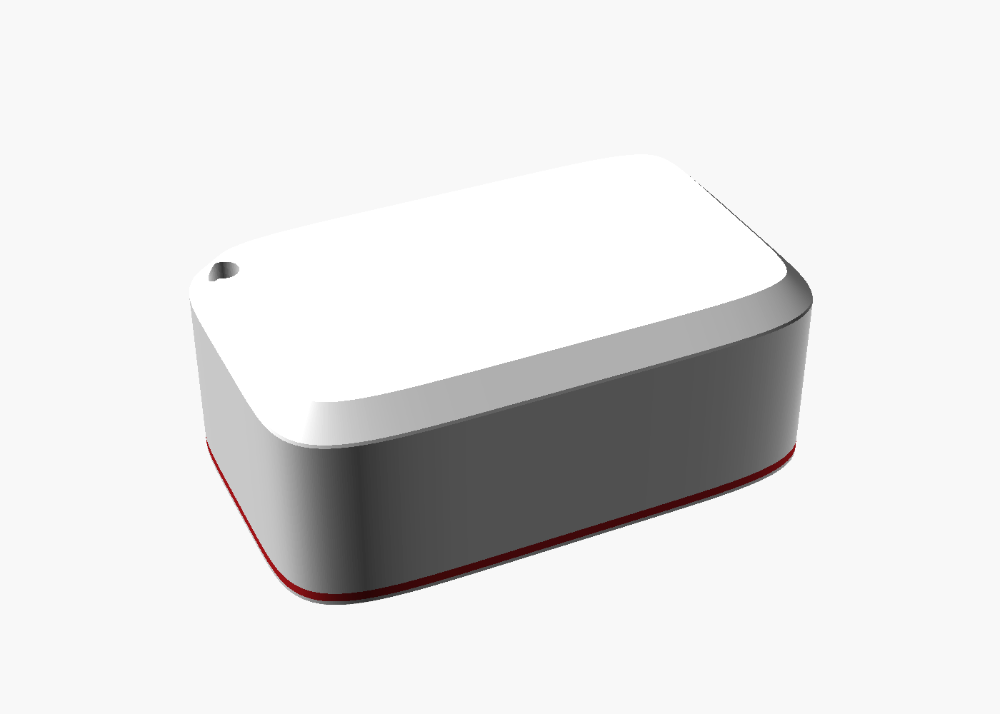
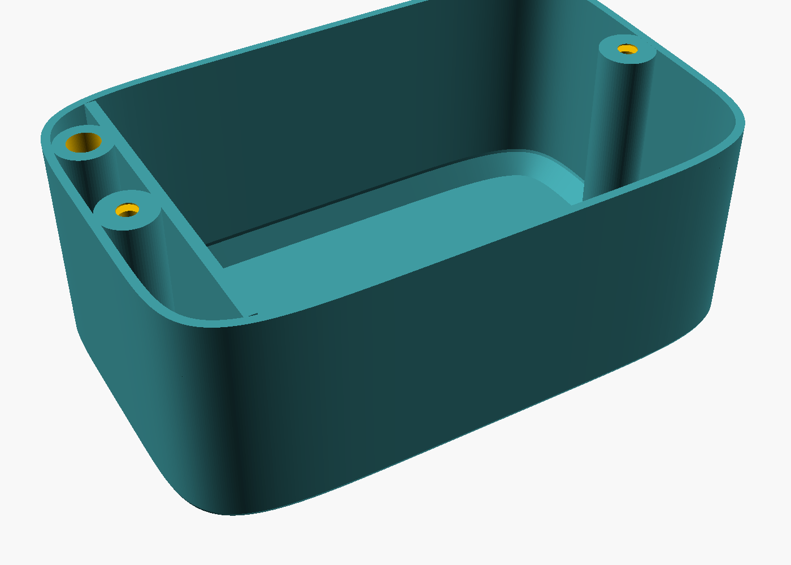

# DIY Find My tracker (ESP32-C3)

A homemade "AirTag" for about €8: an **ESP32-C3 SuperMini** and **3 × AA batteries**
in a 3D-printed case. It broadcasts on Apple's **Find My** network, so any iPhone
that passes by anonymously reports its location. **Home Assistant** collects the
reports, and at home a set of ESPHome room hubs can tell you **which room it's near**.

<p align="center">
  
  
</p>

- **No GPS, SIM or WiFi on the tracker.** It only sends short Bluetooth advertisements.
- **Battery life:** about 2–4 months on 3 × AA; up to about a year if you remove
  the board's always-on power LED. The CPU light-sleeps between advertisements.
- **Battery level** is measured by the tracker and reported through Find My
  (Full / Medium / Low / Critical).
- **Room level at home (optional):** "Near Kitchen", "Near Bedroom"... using
  ESPHome Bluetooth proxies and the included Home Assistant integration.

> **Not affiliated with Apple.** This uses the reverse-engineered Find My
> "offline finding" format made public by [OpenHaystack](https://github.com/seemoo-lab/openhaystack).
> Use it **only for your own belongings, never to track a person.** iPhones will
> show an "Unknown accessory detected" alert when one travels with someone,
> which is Apple's anti-stalking protection doing its job.

---

## Contents

- [How it works](#how-it-works)
- [Repository layout](#repository-layout)
- [What you need](#what-you-need)
- [One-time setup](#one-time-setup)
- [Build a tracker](#build-a-tracker)
- [Home Assistant](#home-assistant)
- [Room detection: "Near &lt;room&gt;"](#room-detection-near-room)
- [Firmware details](#firmware-details)
- [Troubleshooting](#troubleshooting)
- [Keep it private](#keep-it-private)
- [Credits and license](#credits-and-license)

A friendly, step-by-step build guide (no tech knowledge assumed) is in
[`docs/`](docs/) as [Markdown](docs/BUILD_GUIDE.md), [Word](docs/DIY%20AirTag%20Build%20Guide.docx)
and [plain text](docs/DIY%20AirTag%20Build%20Guide.txt). It was written for the
author's own setup (for example an iPhone app called Orbit Home), so treat
those parts as examples. This README is the general reference.

---

## How it works

```
                    Away from home                               At home (optional)

 ┌───────────┐  Bluetooth   ┌─────────┐  encrypted   ┌───────┐    ┌───────────────┐
 │  Tracker  │ ───────────► │ iPhones │ ───────────► │ Apple │    │ ESPHome room  │
 │ ESP32-C3  │  every 2 s   │ nearby  │  location    │servers│    │ hubs (BLE     │
 │  + 3×AA   │              └─────────┘              └───┬───┘    │ proxies)      │
 └─────┬─────┘                                           │        └──────┬────────┘
       │ same advertisements, heard locally ─────────────┼───────────────┘
       │                                                 │ fetch + decrypt  │ RSSI per room
       │                                           ┌─────▼──────────────────▼──────┐
       │                                           │ Home Assistant                │
       │                                           │  hass-FindMy → device_tracker │
       │                                           │  Find My Rooms → "Near Kitchen"│
       │                                           └───────────────────────────────┘
```

1. **Keys.** Each tracker gets 12 key pairs, made with
   [go-haystack](https://github.com/hybridgroup/go-haystack). Only the 12 **public**
   (advertisement) keys go into the firmware; the private keys stay on your computer
   and in Home Assistant.
2. **Advertising.** The tracker advertises one public key every 2 s and moves to the
   next key every 5 minutes (so it has a new Bluetooth address every 5 minutes, like an AirTag).
3. **Reports.** Passing Apple devices encrypt their own location with that public
   key and upload it. Only the private key can decrypt it.
4. **Home Assistant.** [hass-FindMy](https://github.com/malmeloo/hass-FindMy)
   (which uses [FindMy.py](https://github.com/malmeloo/FindMy.py)) fetches and
   decrypts the reports and creates `device_tracker.findmy_<name>`.
5. **Rooms (optional).** ESPHome devices you already have can act as Bluetooth
   proxies. The **Find My Rooms** integration in this repo recognises your trackers
   from their public keys and reports the room whose hub hears them best.

---

## Repository layout

| Path | What |
|---|---|
| `main/`, `CMakeLists.txt`, `sdkconfig.defaults` | Tracker firmware (ESP-IDF 5.4, NimBLE, light sleep) |
| `sdkconfig.test-*` | Extra config fragments used while testing power saving |
| `tools/new-tracker.sh` | Make keys → build → flash → Home Assistant key file, for one tracker |
| `tools/gen_keys_h.py` | Write `main/keys.h` (public keys only) from a go-haystack `.keys` file |
| `tools/add-to-rooms.sh` | Add a tracker to room detection in Home Assistant |
| `case/` | 3D-printed case: OpenSCAD source, STLs, ready-to-print Bambu 3MFs, slicer profiles, previews |
| `homeassistant/` | **Find My Rooms** custom integration, example config, ESPHome proxy example |
| `docs/` | Step-by-step build guide (Markdown, Word, plain text) |

`main/keys.h` is generated per tracker and is **git-ignored**, so keys never end up in the repo.

---

## What you need

### Parts (per tracker, about €7–9)

| Part | Notes |
|---|---|
| ESP32-C3 SuperMini | The tiny board with USB-C. |
| Flat 3 × AA battery holder with wires | About 58 × 47 × 21 mm with cells in (the case is sized for this). |
| 3 × AA alkaline batteries | |
| 2 × 1 MΩ resistors | Battery voltage divider. |
| 1 × 100 nF ceramic capacitor ("104") | Steadies the divider for the ADC. |
| Wire, heat-shrink or tape | Insulate every joint. |
| Double-sided tape: ~1 mm foam + thin | Holds the battery holder in the case. |
| 2 × flat-head wood screws, 3–4 mm × 12–20 mm | Close the case. |
| PLA: white + a little red | The red is only the thin stripe at the base; one colour works too. |

**Tools:** soldering iron, multimeter, USB-C cable, small screwdriver, 3D printer.

### Wiring

```
Battery + (red)  ──┬──────────────► 5V  (SuperMini)
                   │
                 [1 MΩ] A
                   │
                   ├───────┬──────► GPIO3   (battery sense, ADC1 ch 3)
                   │       │
                 [1 MΩ] B [100 nF]
                   │       │
Battery − (black) ─┴───────┴──────► G   (GND)
```

- The 3 × AA pack (≈4.5 V fresh) feeds the board's 5V pin; the on-board regulator
  makes 3.3 V.
- The two equal resistors halve the pack voltage for GPIO3 (ratio 2000 ×1000 in the
  firmware config). Calibrate against a multimeter if you want exact numbers.
- ⚠️ **Never connect USB while the batteries are in.**
- ⚠️ Don't use black or pink anti-static foam in the case (it's conductive).

Check with a multimeter before powering it: GPIO3 ↔ G should settle around 1 MΩ,
and there should be no continuity between GPIO3 and GPIO4, GPIO3 and 3.3V, or 5V and G.

---

## One-time setup

Tested on macOS; Linux works the same way with different serial port names.

1. **ESP-IDF v5.4** (the firmware framework): follow
   [Espressif's install guide](https://docs.espressif.com/projects/esp-idf/en/v5.4/esp32c3/get-started/index.html).
   The scripts expect the activate script at
   `~/.espressif/tools/activate_idf_v5.4.4.sh` (override with `IDF_ENV=...`).
2. **go-haystack** (key generation and a handy scanner), needs Go:
   ```bash
   go install github.com/hybridgroup/go-haystack/cmd/haystack@latest
   mkdir -p ~/Projects/go-haystack        # where keys are kept (override with KEYDIR=...)
   ```
3. **FindMy.py** in a virtual environment (turns the keys into the file hass-FindMy imports):
   ```bash
   python3 -m venv ~/Projects/findmy-fetch/.venv      # override with FETCH=...
   ~/Projects/findmy-fetch/.venv/bin/pip install "findmy>=0.10"
   ```
4. **This repo:**
   ```bash
   git clone https://github.com/lucaregianini/esp32c3-findmy-tracker.git ~/Projects/c3-findmy-fw
   ```
   (The build guide in `docs/` uses the path `~/Projects/c3-findmy-fw`; any path works for the scripts.)
5. **Home Assistant:** install [hass-FindMy](https://github.com/malmeloo/hass-FindMy)
   from HACS and sign in with an Apple ID (a secondary Apple ID is a good idea).

---

## Build a tracker

### 1. Print the case

Open `case/print/C3 Tracker - Shell (white + red stripe).3mf` and
`case/print/C3 Tracker - Back (white).3mf` in Bambu Studio (sliced for a Bambu Lab
A2L, 0.4 mm nozzle, 0.20 mm Standard, PLA), or slice `case/c3_tracker_shell.stl`
and `case/c3_tracker_back.stl` for your own printer. Both print flat without
supports: the shell **top face down**, the back **outside face down**. Turn off the
prime tower; the red stripe is a single filament change at the base.

To change the size or shape, open `case/c3_tracker_case.scad` in
[OpenSCAD](https://openscad.org) (**Window → Customizer**). `case/bambu/README.txt`
explains how the 3MFs were built.

### 2. Solder

Battery red → **5V**, black → **G**, plus the divider to **GPIO3** as shown in
[Wiring](#wiring). Insulate everything.

### 3. Flash

Batteries **out**, board on USB, then:

```bash
~/Projects/c3-findmy-fw/tools/new-tracker.sh keys        # "keys" = your tracker's name
```

The name uses lowercase letters, digits and `_`, and becomes `device_tracker.findmy_<name>`.
The script:

1. creates 12 key pairs with go-haystack (`<name>.keys`, `<name>.json`), or reuses them
   if the name already exists, so re-flashing keeps the tracker's identity;
2. writes `main/keys.h` with the **public** keys and builds the firmware;
3. asks before erasing and flashing the board (auto-detects a single `/dev/cu.usbmodem*`,
   or pass the port as a second argument);
4. writes `<name>.findmy.json`, the file hass-FindMy imports;
5. offers to add the tracker to room detection (see below).

If flashing fails because the board is asleep: hold **BOOT**, tap **RST**, release
**BOOT**, and run it again.

### 4. Check it's broadcasting

Unplug USB, insert the batteries, then:

```bash
cd ~/Projects/go-haystack && ~/go/bin/haystack scan
```

Look for a line ending in `- battery full` with a signal around −40 to −65 dBm.
Press Ctrl-C to stop.

### 5. Assemble

Battery holder into the shell with the cells facing the open side and the wires at
the end with the larger gap. Foam tape on the short end without wires, **thin** tape
on the long sides (there's only 0.5 mm of room). Board and divider lie flat in the
~8 mm space on top. Close the back with the two screws; don't over-tighten.

---

## Home Assistant

### Add the tracker

**Settings → Devices & services → FindMy → Add device → "Rolling-key device with
pre-generated keys"**, use the same name, and upload `<name>.findmy.json` from your
key folder. You get `device_tracker.findmy_<name>` with location, accuracy, a
battery level (90 / 65 / 40 / 15 %) and the time of the last report.

### Fetch more often while it's away (optional)

hass-FindMy polls on its own schedule. This automation asks for fresh reports every
5 minutes, but only while a tracker is away from home. Several trackers are still one
request to Apple.

```yaml
alias: Find My trackers – fetch every 5 min while away
triggers:
  - trigger: time_pattern
    minutes: "/5"
variables:
  away: >
    {{ ['device_tracker.findmy_keys',
        'device_tracker.findmy_backpack']
       | reject('is_state', 'home') | list }}
conditions:
  - condition: template
    value_template: "{{ away | count > 0 }}"
actions:
  - action: homeassistant.update_entity
    target:
      entity_id: "{{ away }}"
mode: single
```

Locations come from passing Apple devices, so they're typically minutes old, and
they won't update in places where no iPhone passes.

---

## Room detection: "Near &lt;room&gt;"

Find My tells you a tracker is **home**. Room detection tells you **where at home**,
using ESPHome devices you probably already have as Bluetooth listeners. It says
"**Near** Kitchen", never "In Kitchen": Bluetooth signal strength through walls and
open hallways is a hint, not a floor plan.

`sensor.<name>_near` (shown as *"&lt;Name&gt; location"*):

| State | When |
|---|---|
| `Near Kitchen` | At least one hub heard the tracker in the last 2 minutes; the strongest (smoothed) wins. |
| `Home` / `Away` / zone name | No hub has heard it for 2 minutes: falls back to the hass-FindMy state. |

Attributes: `room`, `source` (`bluetooth` / `find_my`), `rssi` per room, `last_seen`,
`seconds_since_seen`, `margin_db`, `battery`, current `address`.

### 1. Turn ESPHome devices into listeners

Any ESP32 or ESP32-C3 running ESPHome with `framework: esp-idf` works. Add the blocks
from [`homeassistant/esphome-proxy-example.yaml`](homeassistant/esphome-proxy-example.yaml):
passive scanning, no connections, and a restart button.

> **Lesson learned on ESP32-C3 SuperMini boards:** with ESPHome's default continuous
> scanning from boot, a hub could no longer finish joining WiFi after a restart
> (auth / 4-way-handshake timeouts, fallback hotspot). The example only starts
> scanning **after WiFi connects**, and stops it on disconnect. Flash one hub at a
> time and press its Restart button 2–3 times to confirm it rejoins before doing the next.
> Hubs with a marginal WiFi signal (around −75 dBm or worse) are better left as
> non-proxies; a neighbouring hub can cover their area.

Each proxy shows up in Home Assistant's Bluetooth integration as a scanner.

### 2. Install the integration

1. Copy `homeassistant/custom_components/findmy_rooms/` to
   `/config/custom_components/findmy_rooms/` (Studio Code Server, Samba or SSH).
2. Copy `homeassistant/findmy_rooms.example.json` to `/config/findmy_rooms.json` and
   edit the room names. `tools/add-to-rooms.sh` fills in trackers for you, and creates
   the file if it's missing.
3. Restart Home Assistant, then **Settings → Devices & services → Add integration →
   Find My Rooms**.

### 3. Add trackers

```bash
~/Projects/c3-findmy-fw/tools/add-to-rooms.sh keys "Keys"
```

It reads the **public** keys from `~/Projects/go-haystack/keys.keys`, adds or updates
the tracker in `/config/findmy_rooms.json` over SSH, and reloads the integration.
`new-tracker.sh` offers to do this for you. It needs SSH to Home Assistant with key
login (for example the *Advanced SSH & Web Terminal* add-on) and a host alias in
`~/.ssh/config`, `ha` by default (override with `HA_SSH=...`).

### 4. Configure

`/config/findmy_rooms.json`:

| Key | Meaning |
|---|---|
| `trackers[]` | `id` (the tracker name), `name` (display name), `find_my_entity` (fallback), `keys` (12 public keys, base64) |
| `rooms_by_source` | Proxy **Bluetooth** MAC → room label. Most precise; see each scanner's MAC in HA's Bluetooth integration. |
| `rooms_by_name` | ESPHome device name → room label. Two hubs can share a room; the stronger one counts. |
| `settings.window_seconds` | RSSI median window (default 45). |
| `settings.switch_margin_db` / `switch_confirm_seconds` | A new room must be this much stronger for this long before switching (defaults 5 dB / 10 s). |
| `settings.lost_after_seconds` | Fall back to Find My after this long unheard (default 120). |
| `settings.rssi_offsets` | Per-room correction in dB, e.g. `{"Office": -6}` for a hub that hears through walls and steals neighbouring rooms. |

JSON changes need only a **reload** of the integration (⋮ → Reload); code changes
need a Home Assistant restart.

**Timing:** a tracker is picked up within about 5–10 s; moving to another room takes
about 20–40 s (deliberately, to avoid flicker); leaving the house falls back to
Find My after 2 minutes.

**Tuning:** walk a tracker around and watch the `rssi` attribute. Cheap boards differ
a lot in how well they hear, so expect to add an offset or two. A hub hidden behind
furniture or lying on metal hears noticeably worse.

**Why polling:** Home Assistant doesn't re-deliver identical advertisements to
callbacks, and a tracker's advertisement stays identical for 5 minutes. So the
integration reads each proxy's own per-address timestamps and RSSI every 5 s.

---

## Firmware details

Settings live in `idf.py menuconfig` → **Find My tracker** (`main/Kconfig.projbuild`):

| Option | Default | Meaning |
|---|---|---|
| `TRACKER_ADV_INTERVAL_MS` | 2000 | Advertising interval (an AirTag away from its owner uses about 2 s). |
| `TRACKER_ROTATION_MIN` | 5 | Minutes on each key before rotating to the next. |
| `TRACKER_BATTERY_CHECK_MIN` | 15 | Minutes between battery readings. |
| `TRACKER_BATTERY_GPIO_CHANNEL` | 3 | ADC1 channel of the divider (GPIO3). |
| `TRACKER_DIVIDER_X1000` | 2000 | Divider ratio × 1000 (2000 = two equal resistors). |
| `TRACKER_BTHOME` | off in `sdkconfig.defaults` | Optional BTHome burst with exact voltage. Uses a fixed address, so it's identifiable. |

Over the air (per key): BLE random static address = `key[0] | 0xC0, key[1..5]`;
Apple manufacturer data (company ID `0x004C`) =
`0x12 0x19 <status> key[6..27] <key[0] >> 6> 0x00`, legacy non-connectable.
The status byte carries battery in bits 6–7 (`0x10` full, `0x40` medium, `0x80` low,
`0xC0` critical). The format is compatible with go-haystack / OpenHaystack keys.

Power: NimBLE broadcaster only, tickless idle with automatic light sleep, CPU
power-down in sleep, and the internal RC as the Bluetooth sleep clock (the SuperMini
has no 32 kHz crystal; fine for advertising). The TX power is +9 dBm (maximum).
The always-on red power LED is the single biggest drain; removing it roughly
triples battery life.

Build manually:

```bash
python3 tools/gen_keys_h.py ~/Projects/go-haystack/keys.keys
idf.py build
idf.py -p /dev/cu.usbmodemXXXX erase-flash flash monitor
```

---

## Troubleshooting

| Problem | Try |
|---|---|
| Not in `haystack scan` | Batteries in? Red LED on? Check the 5V/G solder joints. |
| In the scan but no location ever | It needs Apple devices nearby. Wait 30 min or take it outside. |
| Location is old | Normal: Apple only has what passing devices reported. Refresh with `homeassistant.update_entity`. |
| "Home" while you're outside | You're probably still within ~100 m of home. |
| hass-FindMy asks to log in again | Apple expired the session; sign in again. |
| Flash failed | BOOT + tap RST, release BOOT, retry. |
| "Unknown accessory detected" on an iPhone | Expected anti-stalking alert. |
| Room sensor stuck on `Home` | No hub hears it. Check `rssi` and the proxies in HA's Bluetooth integration. |
| Wrong room through a wall | Add a negative `rssi_offsets` entry for the room that steals it, or a second hub in the right room. |
| A proxy hub drops off WiFi after adding Bluetooth | Use the WiFi-gated scanning from the example, or leave that hub as a non-proxy. |

---

## Keep it private

- **Never** share the `.keys`, `.json` or `.findmy.json` files: they contain the private keys.
- `main/keys.h` only contains public keys, but it's git-ignored anyway.
- The room integration and `add-to-rooms.sh` only ever use public keys.
- Only track your own things.

---

## Credits and license

- [OpenHaystack](https://github.com/seemoo-lab/openhaystack) (SEEMOO Lab, TU Darmstadt): the research and protocol this builds on.
- [go-haystack](https://github.com/hybridgroup/go-haystack): key generation and scanning.
- [FindMy.py](https://github.com/malmeloo/FindMy.py) and [hass-FindMy](https://github.com/malmeloo/hass-FindMy): fetching and decrypting reports into Home Assistant.
- [ESPHome](https://esphome.io) Bluetooth proxies and [ESP-IDF](https://github.com/espressif/esp-idf).

The firmware, tools, integration and case in this repository are released under the
[MIT License](LICENSE). "Apple", "AirTag" and "Find My" are trademarks of Apple Inc.;
this project is not affiliated with or endorsed by Apple.
